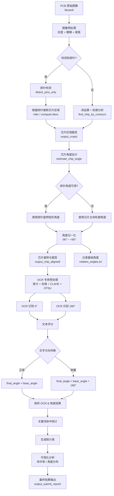

# 芯片检测、角度校正与文字识别系统

## 1. 任务描述（Task Description）

本项目以实际 PCB 板图像为研究对象，设计并实现了一套 **芯片检测、角度校正与文字识别的自动化处理流程**。

**任务概述**

- **输入数据**：
   位于 `3board/` 目录下的 PCB 板原始图像。图像中包含目标芯片、排针结构以及其他元器件和背景干扰。
   
- **任务目标**：
   对输入的 PCB 图像进行自动处理，完成从整板图像到芯片信息提取的完整流程，主要包括以下步骤：
   **芯片定位 → 芯片裁剪 → 芯片角度估计与摆正 → 芯片文字方向判断与 OCR 识别**。
   
- **输出结果**：
   系统在各处理阶段均会输出对应的中间结果与最终结果，并按功能模块分别存放在不同的目录中，例如芯片裁剪结果、角度校正结果、OCR 识别结果及统计分析文件。
   这种分阶段、分目录的输出方式，既便于算法调试和结果核查，也满足课程作业与实验报告对结果可复现性的要求。
   

**任务分析**

   - 难点：PCB板上不光有主要识别的芯片，也有诸多其他次要的芯片，不光主芯片上有文字即需要识别的文字，PCB板上也有一些其他文字会产生影响。
   - 本次识别芯片会遇到芯片无法正确定位，芯片摆正后无法判断正反等问题，因此需要一个逐步递进的处理流程

**任务特点**

- 本项目采用 **基于传统图像处理的方法**，结合芯片排针等结构特征完成芯片检测与姿态估计，不依赖深度学习模型。
- 系统整体流程模块化设计，各功能模块相互独立，便于单独调试与后续扩展。
- 项目不仅关注芯片的定位与识别结果，同时对中间处理过程进行保存与分析，增强了系统的可解释性。

## 2. 整体算法流程（Overall Pipeline）

本系统采用 **自上而下、分阶段处理** 的整体流程设计，将复杂的 PCB 芯片识别任务拆分为若干相互独立但顺序衔接的模块。各模块以前一阶段的输出作为输入，逐步完成从整板图像到芯片文字信息提取的处理过程。

系统总体流程说明




**系统的整体处理流程如下：**

1. **芯片检测与裁剪**
    从 PCB 原始图像中自动定位目标芯片区域，并将芯片从整板图像中裁剪出来。
2. **芯片角度估计与摆正**
    对裁剪后的芯片图像进行角度估计，并将芯片旋转至统一、规范的方向。
3. **芯片文字方向判断与 OCR 识别**
    对摆正后的芯片图像进行文字方向判断与 OCR 识别，输出芯片上的文字信息。
4. **结果汇总与性能评估**
    对 OCR 结果与角度信息进行统计分析，生成用于评估系统性能的结果文件与可视化图表。

整个流程按顺序依次执行，各阶段均保留中间结果，保证处理过程可追溯、可复现。

**各模块之间的数据流关系**

系统中各模块之间的数据流关系如下：

- **输入数据**：
   PCB 原始图像（`3board/`）
- **中间结果**：
  - 芯片裁剪图像（由芯片检测模块输出）
  - 芯片角度信息与摆正后的芯片图像（由角度估计模块输出）
  - OCR 预处理结果与识别文本（由文字识别模块输出）
- **最终结果**：
  - 芯片文字识别结果
  - 芯片最终角度信息
  - 识别准确率与统计分析结果

这种**流水线式的数据流设计**，使得每个模块都可以独立调试，同时又能保证整体流程的连贯性。

**脚本对应关系说明**

系统中各处理阶段与脚本文件之间的对应关系如下：

| 功能模块           | 对应脚本                     | 主要输入       | 主要输出             |
| ------------------ | ---------------------------- | -------------- | -------------------- |
| 芯片检测与裁剪     | `chip_detection_and_crop.py` | PCB 原始图像   | 芯片裁剪图           |
| 芯片角度估计与摆正 | `chip_angle_alignment.py`    | 芯片裁剪图     | 摆正芯片图、角度信息 |
| 芯片文字识别       | `chip_text_ocr_2.py`         | 摆正芯片图     | OCR 结果、最终角度   |
| 结果统计与分析     | `report_submit_results.py`   | OCR 与角度结果 | 统计文件与可视化结果 |

### 2.1 芯片检测与裁剪模块

芯片检测与裁剪模块是整个系统的第一步，其目标是在包含复杂背景和多种元器件的 PCB 图像中，**自动定位目标芯片并提取其区域**，为后续角度估计与文字识别提供规范化输入。

在该模块中，系统首先对 PCB 原始图像进行基础的图像预处理，以减弱噪声并突出芯片及其排针结构。随后，利用芯片排针所具有的 **规则形状和几何分布特征**，对芯片位置进行推断。

当排针结构能够被可靠检测时，系统优先基于排针的空间分布关系推断芯片主体区域；当排针检测不稳定或失败时，系统则退化为基于图像轮廓的检测策略，通过轮廓面积和长宽比等几何约束对芯片区域进行兜底定位。

最终，系统从原始 PCB 图像中裁剪出芯片区域，并将裁剪结果单独保存。通过这一模块，后续处理阶段不再受整板图像尺寸和复杂背景的影响，从而显著提高了角度估计与文字识别的稳定性。

### 2.2 芯片角度估计与摆正模块

在完成芯片区域裁剪后，不同芯片在图像中仍可能存在旋转、倾斜等姿态差异。若直接对原始裁剪图像进行文字识别，容易因文字方向不一致而导致识别准确率下降。因此，本模块的主要目标是 **估计芯片的旋转角度，并将芯片图像统一摆正**。

首先，系统对裁剪后的芯片图像进行灰度化与阈值分割，获得芯片区域的二值掩膜。在此基础上，优先检测芯片排针结构，并利用排针所呈现的细长几何形态，拟合其最小外接旋转矩形。通过分析该旋转矩形的主轴方向，可以较为稳定地获得芯片的整体旋转角度。

当排针结构不完整或检测不稳定时，系统会退化为基于芯片整体轮廓的角度估计方法，通过对芯片主体轮廓拟合旋转矩形，估计芯片的主方向。无论采用哪种方式，系统都会对角度进行统一归一化处理，保证角度范围的一致性，从而避免后续旋转方向混乱的问题。

在角度估计完成后，系统根据估计得到的角度对芯片图像进行旋转校正，并对旋转后的图像进行裁剪，生成姿态规范、方向统一的芯片图像。摆正后的芯片图像被单独保存，并作为后续文字方向判断与 OCR 识别模块的输入。

通过该模块的处理，不仅消除了芯片在拍摄过程中的随机旋转影响，也为后续文字识别提供了更加稳定和一致的输入条件，从而提高了整个系统的识别鲁棒性和准确性。

### 2.3 芯片文字识别与方向判断模块

在完成芯片角度估计与姿态校正后，芯片图像已经具有较为统一的空间方向，但芯片丝印文字仍可能存在上下颠倒的情况。为此，本模块在进行文字识别之前，首先对芯片文字方向进行判断，并在此基础上完成芯片文字的 OCR 识别。

本模块首先针对芯片丝印字符尺寸较小、对比度较低的特点，对摆正后的芯片图像进行专门的 OCR 预处理操作，包括图像放大、去噪以及对比度增强等处理步骤，以提高字符与背景之间的区分度。经过预处理后，系统能够获得更适合文字识别的二值化图像。

在文字方向判断阶段，系统分别对芯片图像在 **当前方向和旋转 180° 后的方向** 进行文字识别，并对两次识别结果进行综合评分。评分依据包括识别字符的数量、字母与数字的比例以及是否包含特定芯片关键词等信息。通过对比两种方向下的识别得分，系统能够自动判断芯片文字的正向或倒置状态。

在确定正确的文字方向后，系统对最终方向下的芯片图像执行 OCR 识别，提取芯片丝印文字信息，并对识别结果进行整理和保存。同时，若在方向判断过程中发生了 180° 翻转操作，系统会将该翻转角度叠加到前一阶段的芯片旋转角度中，得到芯片的最终角度信息。

通过该模块的处理，系统不仅能够完成芯片文字的自动识别，还能够保证文字方向的一致性和结果的合理性，为后续的结果统计与性能评估提供可靠的数据基础。

### 2.4 结果汇总与评估模块

在完成芯片检测、角度校正以及文字识别之后，系统需要对前序模块的输出结果进行统一整理与评估。本模块的主要作用是 **汇总各阶段产生的结果数据，并对芯片文字识别效果进行定量分析与可视化展示**。

本模块以芯片文字识别结果和角度信息作为输入，对每张芯片图像的 OCR 结果进行解析，并基于预先设定的关键词，对识别文本进行逐项匹配统计。通过统计每个关键词的命中情况，系统能够计算单张图像的识别准确率以及整体数据集的平均识别准确率，从而对系统性能进行量化评估。

在角度信息方面，本模块分别对芯片的原始旋转角度和最终角度进行整理和保存，便于分析芯片在不同阶段的姿态变化情况。通过对角度数据的统计，可以直观地观察角度校正模块的效果。

此外，为了增强结果分析的直观性，本模块还对识别结果和角度信息进行可视化处理，生成多种统计图表，例如关键词命中率分布、单张图像识别准确率分布以及角度分布图等。这些可视化结果为系统性能分析和结果展示提供了直观依据。

通过结果汇总与评估模块，整个系统的输出从单一的识别结果提升为可分析、可比较的统计数据，使得系统性能能够被客观评价，也为后续算法改进提供了参考基础。


## 3. 算法实现细节（Implementation Details）

### 3.1 芯片区域检测方法

芯片区域检测是整个系统的基础，其目标是在复杂 PCB 背景下，稳定、准确地定位目标芯片区域。针对 PCB 图像中背景复杂、元器件种类多、芯片外观差异较大的特点，本系统采用了 **“预处理 + 结构特征优先 + 兜底策略”** 相结合的方法进行芯片区域检测。

**图像预处理思路**

在芯片检测之前，系统首先对 PCB 原始图像进行基础的图像预处理操作，以降低噪声并增强芯片与背景之间的对比度。主要处理思路包括：

- 对原始彩色图像进行灰度化处理，简化后续分析过程；
- 通过平滑滤波抑制高频噪声，减少焊盘、线路等细碎结构对芯片检测的干扰；
- 对灰度图像进行阈值分割，使芯片及其排针结构在二值图像中更加突出。

对应的实现函数为 `preprocess_board_image_simple`，其核心流程如下所示：

```text
Algorithm 1: preprocess_board_image_simple
Input:  PCB color image bgr_img
Output: binary image binary

1:  blur_img ← GaussianBlur(bgr_img, ksize = 9)
2:  gray ← ConvertToGray(blur_img)
3:  if USE_OTSU = True then
4:      binary ← OTSUThreshold(gray, inverse = True)
5:  else
6:      binary ← FixedThreshold(gray, TH = 120, inverse = True)
7:  end if
8:  return binary

```

经过上述预处理后，芯片区域在图像中能够以相对连续、规则的形态呈现，为后续的结构分析提供基础。

**排针检测策略**

针对本任务中芯片普遍具有 **规则排针结构** 的特点，系统优先利用排针作为芯片定位的重要结构特征。排针通常具有以下特点：

- 呈现为细长矩形结构；
- 具有较为统一的尺寸范围。

基于上述特征，系统在二值图像中对候选轮廓进行筛选，通过面积约束和长宽比约束，过滤掉不符合排针几何特征的干扰轮廓。该过程由函数 `detect_pins_only` 实现，其核心逻辑如下：

```text
Algorithm 2: detect_pins_only
Input:  binary image binary_img
Output: pin_rects (list of pin bounding boxes)

1:  inv ← Invert(binary_img)
2:  proc ← MorphOpen(inv, kernel = 3×3)
3:  contours ← FindContours(proc)

4:  pin_rects ← ∅
5:  for each contour c in contours do
6:      area ← Area(c)
7:      if area ∉ [MIN_AREA, MAX_AREA] then continue
8:      rect ← MinAreaRect(c)
9:      if not PassPinGeometryConstraints(rect) then continue
10:     bbox ← BoundingRect(c)
11:     pin_rects ← pin_rects ∪ {bbox}
12: end for

13: return pin_rects

```

在检测到排针后，系统实现了两种基于排针的芯片区域推断方法，分别对应函数 `compute_chip_core_from_pins` 与 `infer_chip_bbox_from_pins`。

```text
Algorithm 3: compute_chip_core_from_pins
Input:  pin_rects, image shape
Output: chip core bounding box or None

1:  if number of pins < 4 then return None
2:  centers ← ComputePinCenters(pin_rects)
3:  groups ← KMeansCluster(centers.y, k = 2)
4:  Sort groups into top and bottom rows
5:  x_range ← IntersectXRangeByPercentile(groups)
6:  y_range ← ComputeVerticalSpan(groups)
7:  box ← ExpandAndClip(x_range, y_range)
8:  return box

Algorithm 4: infer_chip_bbox_from_pins
Input:  pin_rects, image shape
Output: chip bounding box or None

1:  centers ← ComputePinCenters(pin_rects)
2:  Remove pins near image borders
3:  groups ← KMeansCluster(centers.y, k = 2)
4:  For each group:
5:      Remove x-direction outliers (percentile-based)
6:      Compute group bounding box
7:  box ← MergeTopAndBottomGroupsWithPadding
8:  box ← ApplySizeConstraints(box)
9:  return box
```

利用排针进行芯片定位，可以有效避免将 PCB 上其他大面积区域或无关元器件误识别为目标芯片，提高检测的稳定性和准确性。

**兜底检测机制**

在实际 PCB 图像中，排针结构可能由于光照、遮挡或成像质量等原因无法被稳定检测。为保证系统的鲁棒性，本项目设计了兜底检测机制。

当排针检测失败或结果不可靠时，系统退化为基于芯片整体轮廓的检测策略。系统首先对二值图像执行形态学闭运算与开运算，将芯片区域“焊接”为连续的实心区域。该过程由函数 `close_chip_mask` 实现：

```text
Algorithm 5: close_chip_mask
Input:  binary image binary_img
Output: clean chip mask

1:  mask ← EnsureBinaryMask(binary_img)
2:  mask ← MorphClose(mask, adaptive kernel, iter = 2)
3:  mask ← MorphOpen(mask, smaller kernel, iter = 1)
4:  return mask

```

随后，系统在闭合后的掩膜图像中进行轮廓分析，通过面积约束和外接矩形长宽比约束，筛选最有可能对应芯片主体的区域。该兜底逻辑由函数 `find_chip_by_contours` 实现：

```text
Algorithm 6: find_chip_by_contours
Input:  binary image, original image
Output: detected chip boxes and auxiliary information

1:  mask ← close_chip_mask(binary image)
2:  pin_rects ← detect_pins_only(binary image)
3:  roi ← infer chip ROI from pins
4:  if roi exists then
5:      Search contours inside ROI and select best candidate
6:  else
7:      Search contours globally with area and aspect constraints
8:  end if
9:  return chip_boxes, mask, pin_rects
```

通过将排针检测作为优先策略，并结合轮廓分析作为兜底方案，系统在保证检测准确性的同时，也具备一定的容错能力，能够适应不同质量和不同拍摄条件下的 PCB 图像。

### 3.2 芯片角度估计与校正方法

在完成芯片区域裁剪后，不同芯片在图像中仍可能存在旋转和姿态不一致的问题。为了保证后续文字识别阶段中芯片方向的统一性，本系统设计了芯片角度估计与校正模块，用于 **自动估计芯片的旋转角度并将芯片图像摆正**。

本模块主要包括：**角度计算原理、旋转与裁剪策略以及角度归一化规则** 三个部分。

**角度计算原理**

芯片角度估计的核心思想是：
 **利用芯片主体或排针结构的主方向，作为芯片整体方向的近似表示**。

系统首先对芯片裁剪图像进行灰度化和阈值分割，得到芯片区域的二值掩膜。在此基础上，优先利用排针结构进行角度估计；若排针不可用，则退化为基于芯片整体轮廓的角度估计。

**其关键步骤包括：**

- 对排针或芯片轮廓拟合最小外接旋转矩形（`minAreaRect`）；
- 以旋转矩形的长边方向作为芯片的主方向；
- 计算芯片相对于水平方向的旋转角度。

对应的实现逻辑与函数 **`estimate_chip_angle`** 一致，其伪代码描述如下：

```text
Algorithm 7: estimate_chip_angle
Input:  bgr_img (cropped chip image)
Output: angle_use (clockwise rotation angle)

1:  gray ← ConvertToGray(bgr_img)
2:  blur ← GaussianBlur(gray)
3:  binary_inv ← OTSUThresholdInverse(blur)

4:  pin_rects, pin_boxes ← detect_pins_only(binary_inv)

5:  if pin_boxes not empty then
6:      rect_pins, angle_pins ← compute_rect_from_pin_boxes(pin_boxes)
7:  end if

8:  mask ← binary_inv
9:  if pin-based ROI exists then
10:     mask ← MaskROI(mask, roi_box)
11: end if

12: mask ← MorphClose(mask)

13: contours ← FindContours(mask)
14: if contours not empty then
15:     c_max ← contour with maximum area
16:     rect_mask ← MinAreaRect(c_max)
17:     angle_mask ← ExtractAngle(rect_mask)
18: end if

19: if rect_pins exists then
20:     angle_use ← angle_pins        // 排针优先
21: else
22:     angle_use ← angle_mask        // 主体轮廓兜底
23: end if

24: angle_use ← NormalizeAngle(angle_use)
25: return angle_use

```

在排针存在的情况下，系统会优先使用排针的旋转矩形来估计角度，以提高角度估计的稳定性：

**旋转与裁剪策略**

在获得芯片旋转角度后，系统需要对芯片图像进行旋转校正。为避免旋转后图像被裁剪或边缘信息丢失，本系统采用 **自适应画布扩展的旋转策略**。

具体做法是：

- 以图像中心为旋转中心；
- 根据旋转角度计算旋转后所需的最小画布尺寸；
- 在旋转时使用白色背景填充新增区域。

其对应实现与函数 **`rotate_image_keep_bounds`** 和 **`crop_after_rotation`** 保持一致，伪代码如下：

```text
Algorithm 8: crop_after_rotation
Input:  img, rect, angle_cw
Output: aligned_crop

1:  rotated_img, M ← rotate_image_keep_bounds(img, -angle_cw)
2:  box ← BoxPoints(rect)
3:  box_rot ← ApplyAffineTransform(box, M)
4:  box_rot ← order_points(box_rot)
5:  aligned_crop ← Crop(rotated_img, box_rot)
6:  return aligned_crop

```

在旋转完成后，系统根据之前计算得到的旋转矩形位置，对芯片区域进行裁剪，得到最终摆正后的芯片图像：

该策略能够保证芯片主体完整保留，同时消除因旋转带来的姿态差异。

**角度归一化规则**

在实际处理过程中，不同图像和不同结构可能会导致角度表示存在歧义。为保证整个系统中角度表示的一致性，本项目对角度进行了统一的归一化约定：

- 角度范围统一映射到 **(-90°, +90°]**；
- 始终保证芯片的长边方向为水平方向；
- 所有角度均以 **顺时针方向为正方向** 进行记录。

归一化处理的核心代码如下，该过程在函数 **`estimate_chip_angle`** 内部完成，其核心逻辑可抽象为以下伪代码：

```text
Algorithm 9: Angle Normalization (inside estimate_chip_angle)
Input:  rect (cx, cy, w, h, angle)
Output: angle_norm

1:  if w < h then
2:      angle ← angle + 90°
3:      swap(w, h)
4:  end if

5:  angle_norm ← ((angle + 90) mod 180) − 90
6:  return angle_norm

```

通过上述角度归一化规则，系统能够保证不同芯片图像之间的角度信息具有一致的物理意义，为后续文字方向判断与结果统计提供可靠的角度基础。

### 3.3 OCR 预处理与识别策略

在完成芯片姿态校正后，芯片图像在空间方向上已经统一，但芯片表面的丝印文字仍具有 **字符尺寸小、对比度低、方向不确定** 等特点。为提高文字识别的稳定性与准确性，本系统针对芯片文字识别任务设计了专门的 OCR 预处理与识别策略，并结合方向判断与角度叠加机制，保证最终识别结果的合理性。

**OCR 专用预处理**

针对芯片丝印字符通常较小、灰度变化不明显的问题，系统在 OCR 识别前对芯片图像进行了专门的预处理操作，其主要目标是 **增强字符特征、抑制背景干扰**。

OCR 预处理主要包括以下步骤：

- 将彩色图像转换为灰度图像；
- 对图像进行放大处理，提高字符在像素层面的分辨率；
- 使用高斯滤波进行轻度去噪，减少噪声对识别的影响；
- 采用 CLAHE（自适应直方图均衡）增强局部对比度；
- 使用 OTSU 方法进行自适应阈值分割，获得适合 OCR 的二值图像。

该过程对应源码中的函数 **`preprocess_for_chip_ocr`**，其伪代码描述如下：

```text
Algorithm 10: preprocess_for_chip_ocr
Input:  aligned chip image bgr
Output: binary image bin_img

1:  gray ← ConvertToGray(bgr)
2:  gray ← Resize(gray, scale = 2.0)
3:  gray ← GaussianBlur(gray, kernel = 5×5)
4:  gray ← ApplyCLAHE(gray)
5:  bin_img ← OTSUThreshold(gray)
6:  return bin_img

```

通过上述处理，芯片文字区域在二值图像中更加清晰，有效提高了 OCR 的识别成功率。

**OCR 文字识别过程**

系统对二值图像执行 OCR 识别，得到芯片丝印文本内容。

本系统采用 **Tesseract OCR 引擎** 进行文字识别，并结合芯片丝印特点进行了参数约束：

- 使用 LSTM OCR 模型（`--oem 3`）；
- 采用适合规则文本的页面分割模式（`--psm 6`）；
- 限制字符白名单为大写字母、数字及常见符号，减少误识别。

该过程在主流程中完成，对应源码中的 OCR 调用逻辑，其伪代码如下：

```text
Algorithm 11: ocr_once
Input:  binary image bin_img
Output: recognized text text_raw

1:  config ← SetTesseractConfig(
        OEM = 3,
        PSM = 6,
        CharWhitelist = [A–Z, 0–9, '-', '.']
    )
2:  text_raw ← TesseractOCR(bin_img, config)
3:  return text_raw

```

通过对比两个方向下的 OCR 评分，系统能够自动选择更合理的文字方向，从而避免人工规则判断的不确定性。

**文字方向判断方法**

尽管芯片整体已经完成姿态校正，但芯片丝印文字仍可能存在 **上下倒置** 的情况。为避免错误识别，本系统在 OCR 识别前引入了 **文字方向自动判断机制**。

系统分别对以下两种方向进行 OCR 识别：

- 当前方向（0°）；
- 将图像旋转 180° 后的方向。

通过对两次 OCR 结果进行评分对比，自动选择更合理的文字方向。评分依据包括：

- 识别字符的总长度；
- 字母数量（字母权重高于数字）；
- 数字数量；
- 是否包含典型芯片关键词（如厂商名、国家标识等）。

该策略对应源码中的函数 **`decide_text_orientation`**，其伪代码如下：

```text
Algorithm 12: decide_text_orientation
Input:  binary image bin_img
Output: orientation ∈ {0°, 180°}

1:  text_0 ← ocr_once(bin_img)
2:  bin_180 ← Rotate(bin_img, 180°)
3:  text_180 ← ocr_once(bin_180)

4:  score_0 ← Score(text_0)
5:  score_180 ← Score(text_180)

6:  if score_0 ≥ score_180 then
7:      return 0°
8:  else
9:      return 180°
10: end if

```

OCR 识别结果在系统中以文本形式保存，并用于后续的统计分析与性能评估。

**角度叠加逻辑**

在文字方向判断过程中，如果系统判定芯片文字需要进行 180° 翻转，则需要将该翻转操作体现在芯片的最终角度信息中。为此，本系统设计了角度叠加逻辑，用于 **融合角度估计阶段与文字方向校正阶段的结果**。

具体规则如下：

- 若文字方向判定为正常方向，则最终角度等于前一阶段估计的芯片角度；
- 若文字方向判定为倒置，则在原有角度基础上叠加 180°。

该逻辑在主流程中实现，对应源码中的角度融合部分，其伪代码描述如下：

```text
Algorithm 13: Final Angle Fusion with Text Orientation
Input:  base_angle, orientation
Output: final_angle

1:  if orientation = 180° then
2:      add_angle ← 180°
3:  else
4:      add_angle ← 0°
5:  end if

6:  if base_angle exists then
7:      final_angle ← base_angle + add_angle
8:  else
9:      final_angle ← None
10: end if

11: return final_angle

```

通过该角度叠加机制，系统能够保证最终输出的角度信息同时反映 **芯片物理姿态** 和 **文字阅读方向**，为后续结果统计与分析提供统一、可靠的角度依据。

### 3.4 数据记录与结果统计方式

为了便于调试、核查以及对系统整体性能进行定量分析，本系统在处理过程中对 **中间结果与最终结果进行分阶段记录**，并在此基础上完成统计指标计算与可视化展示。

**中间结果与结果文件记录方式**

系统在各处理阶段均对关键中间结果与最终结果进行保存，并采用 **按功能模块分目录存放** 的方式，保证数据结构清晰、层次分明。主要涉及的结果文件包括：

- **OCR 识别结果文件（`ocr_results.txt`）**
   记录每张芯片图像对应的 OCR 识别文本，作为后续关键词统计的输入。
- **原始角度记录文件（`rotation_angles.txt`）**
   记录芯片在角度估计阶段得到的基础旋转角度。
- **角度融合结果文件（`angles_with_orientation.txt`）**
   记录基础角度、文字方向修正角度以及最终角度，反映姿态校正与文字方向融合后的结果。
- **统计汇总输出文件（TSV / TXT）**
   包括关键词命中情况表、角度汇总表以及整体准确率统计文件。

OCR 结果与角度信息均采用 **制表符分隔文本格式（TSV）** 存储，便于后续程序解析与人工检查。其核心记录逻辑如下：

```text
Algorithm 13: Record OCR and Angle Results
Input:  image name, ocr_text, base_angle, add_angle, final_angle
Output: appended result files

1:  write (name, ocr_text) to ocr_results.txt
2:  write (name, base:base_angle, add:add_angle, final:final_angle)
    to angles_with_orientation.txt

```

通过对中间结果的逐步保存，可以方便地对每一阶段的输出进行单独检查，从而快速定位问题。

**统计指标定义**

在结果统计阶段，系统以 OCR 识别文本为基础，引入 **关键词命中率** 作为主要性能评估指标。系统预先定义若干与芯片型号和厂商相关的关键词，对 OCR 结果进行逐一匹配。

统计指标定义如下：

- **单关键词命中值**：
   若 OCR 识别文本中包含指定关键词，则记为 1，否则记为 0。
- **单图像命中数**：
   单张芯片图像中命中的关键词总数。
- **单图像命中率**：
   单张图像命中关键词数量与关键词总数之比。
- **总体平均命中率**：
   所有图像命中率的平均值，用于衡量系统整体识别性能。

上述过程对应源码中的 `evaluate_tokens` 函数，其伪代码描述如下：

```text
Algorithm 14: Evaluate Keyword Hits
Input:  OCR text text
Output: hit list hits, accuracy acc

1:  text_upper ← ToUpperCase(text)
2:  for each token in TOKENS do
3:      if token in text_upper then
4:          hit ← 1
5:      else
6:          hit ← 0
7:      end if
8:      append hit to hits
9:  end for
10: acc ← Sum(hits) / |TOKENS|
11: return hits, acc

```

通过上述指标，系统能够对 OCR 识别效果进行直观、量化的评估。

**统计汇总表生成**

在完成单图像统计后，系统进一步生成多份汇总文件，包括：

- **关键词命中统计表（`token_accuracy.tsv`）**
    记录每张图像的 OCR 文本、各关键词命中情况、命中数及命中率。
- **整体准确率摘要文件（`accuracy_summary.txt`）**
    记录数据集规模与总体平均命中率。
- **角度统计表（`angles_original.tsv` 与 `angles_final.tsv`）**
    分别记录原始角度与融合后的最终角度信息。

其可视化生成流程如下：

```text
Algorithm 15: Aggregate OCR and Angle Statistics
Input:  OCR results, angle records
Output: summary tables and statistics

1:  for each image result do
2:      hits, acc ← EvaluateKeywordHits(text)
3:      write per-image statistics to token_accuracy.tsv
4:  end for
5:  overall_accuracy ← Mean(acc over all images)
6:  write overall statistics to accuracy_summary.txt
7:  write angle tables (original and final)

```

**可视化结果生成方式**

为了直观展示系统性能，本项目在统计阶段对 OCR 命中情况和角度数据进行了可视化处理，生成多种统计图表，用于分析与展示。主要包括：

- **关键词命中率柱状图**：
   展示不同关键词在整个数据集中的命中比例。
- **逐图命中率条形图**：
   对比不同芯片图像的 OCR 识别效果差异。
- **最终角度分布直方图**：
   展示芯片姿态校正后角度的整体分布情况。
- **原始角度与最终角度对比散点图**：
   用于分析文字方向修正对角度结果的影响。

其可视化流程对应源码中的 `make_plots` 函数，可概括为如下伪代码：

```text
Algorithm 16: Generate Result Visualizations
Input:  per-image statistics, angle records
Output: saved plot images

1:  plot bar chart of keyword hit rates
2:  plot horizontal bar chart of per-image accuracy
3:  plot histogram of final angles
4:  plot scatter of base angle vs final angle
5:  save all figures to report directory

```


通过上述可视化结果，系统的识别性能和角度校正效果能够被直观地展示，为实验分析和结果汇报提供有力支撑。

------

## 4. 测试结果与分析（Experimental Results）

### 4.1 测试数据说明

为验证所设计**芯片检测、角度校正与文字识别系统**的有效性，本项目在实际 PCB 图像数据上对系统整体流程进行了测试与分析。

**数据来源**
 测试数据来源于 `3board/` 目录下的 PCB 板原始图像。图像均为真实拍摄的 PCB 板照片，包含目标芯片、排针结构以及其他电子元器件和背景线路，具有一定的复杂性，能够较好地反映实际应用场景。

**数据规模**
 测试集中共包含多张 PCB 图像。通过芯片检测与裁剪模块，从原始 PCB 图像中自动提取出若干张目标芯片图像，并以这些裁剪后的芯片图像作为后续角度估计与 OCR 识别模块的输入。最终参与 OCR 识别与结果统计的芯片样本数量与系统输出结果文件中的记录数量保持一致。

**测试条件**
 测试在统一的软件环境下进行，系统按既定处理流程依次执行芯片检测、角度估计、文字方向判断与 OCR 识别，各阶段均采用相同的参数设置，不针对单张图像进行人工调参。
 在测试过程中，所有中间结果和最终结果均被保存，用于后续的结果核查与性能分析，从而保证测试结果的客观性和可复现性。

### 4.2 OCR 识别结果分析

在完成芯片文字识别与结果统计后，本节从 **关键词命中率** 和 **单图识别效果** 两个方面，对系统的 OCR 识别性能进行分析。

**关键词命中率分析**

为对 OCR 识别结果进行定量评估，系统选取了若干与芯片型号和厂商信息相关的关键词作为评估对象，对每张芯片图像的识别文本进行匹配统计。若识别结果中包含指定关键词，则认为该关键词在该图像中被成功识别。

从整体统计结果来看，不同关键词的命中率存在一定差异。
 厂商名称和国家标识类关键词由于字符结构较为清晰、字母数量较多，整体命中率相对较高；而包含字母与数字混合、字符较长的型号类关键词，对 OCR 识别质量要求更高，其命中率相对较低。

关键词命中率的统计结果表明，系统在识别 **字符结构清晰、对比度较高的芯片丝印信息** 时具有较好的稳定性，而在处理字符密集或对比度较低的丝印信息时，仍存在一定的识别难度。

**单图识别效果分析**

除整体关键词命中率外，系统还对每一张芯片图像的 OCR 识别效果进行了单独统计分析。单图识别效果通过 **单张图像命中关键词数量与关键词总数的比例** 进行衡量，用于反映不同芯片样本之间的识别差异。

从单图识别结果可以观察到：

- 部分芯片图像能够同时命中多个关键词，OCR 识别效果较好；
- 少数图像由于丝印模糊、光照不均或字符缺失，仅能识别出部分关键词；
- 个别图像中，OCR 识别结果存在字符缺失或误识别现象，导致命中率偏低。

这种差异主要与芯片表面丝印清晰度、拍摄角度以及局部光照条件有关。整体来看，系统在多数样本上能够获得可用的文字识别结果，表明所设计的 OCR 预处理与方向判断策略在实际数据上具有一定的有效性。

### 4.3 角度估计结果分析

在完成芯片角度估计与姿态校正后，本节从 **原始角度分布** 和 **校正后角度分布** 两个方面，对系统的角度处理效果进行分析。

**原始角度分布分析**

原始角度指芯片在裁剪后、未进行姿态校正之前所估计得到的旋转角度。该角度主要反映芯片在 PCB 板拍摄过程中由于放置方向、相机视角等因素所产生的随机旋转情况。

从原始角度统计结果可以看出，芯片的初始角度分布较为分散，覆盖了较宽的角度范围。这说明在原始 PCB 图像中，芯片并未呈现统一的方向，直接对其进行文字识别将面临较大的方向不确定性。

原始角度分布的离散性验证了引入角度估计与校正模块的必要性，也为后续姿态校正效果的对比分析提供了基准参考。

**校正后角度分布分析**

校正后角度是在原始角度的基础上，结合芯片姿态校正与文字方向判断结果得到的最终角度。该角度不仅反映了芯片的物理旋转状态，也包含了文字方向修正所引入的角度调整。

从校正后的角度分布可以观察到，大多数芯片的最终角度集中在较小的角度范围内，分布明显收敛，相比原始角度分布具有更好的集中性。这表明角度校正模块能够有效消除芯片在拍摄过程中的随机旋转影响。

此外，通过对比原始角度与最终角度的对应关系可以发现，系统在检测到文字倒置的情况下，能够正确地对角度进行 180° 叠加修正，从而保证芯片在最终输出中具有一致、可读的方向。

总体而言，角度估计与校正模块在测试数据上表现稳定，能够为后续的 OCR 识别和结果统计提供方向统一的输入条件，对系统整体性能提升起到了关键作用。


## 5. 总结与展望（Conclusion & Future Work）

本项目围绕 PCB 图像中芯片的自动识别任务，完成了一套从 **芯片检测、角度估计与校正到文字识别与结果统计** 的完整处理流程，并在实际 PCB 图像数据上对系统进行了测试与分析。

**本项目完成情况总结**

本项目基于传统图像处理方法，实现了对 PCB 板中目标芯片的自动定位与裁剪，并通过排针结构与轮廓信息完成芯片角度估计与姿态校正。在此基础上，系统结合 OCR 专用预处理与文字方向判断策略，实现了芯片丝印文字的自动识别。

通过对中间结果的分阶段保存以及对识别结果的统计与可视化分析，系统能够对自身性能进行定量评估。实验结果表明，该系统在测试数据上能够稳定完成芯片检测与识别任务，验证了所设计方法的可行性。

**方法优点**

本项目所采用的方法具有以下优点：

1. **流程完整、结构清晰**
    系统覆盖从原始 PCB 图像到芯片文字识别结果的完整处理链路，各模块功能明确，便于理解与扩展。
2. **不依赖深度学习模型**
    全流程基于传统图像处理与几何分析方法实现，无需训练数据，算法过程具有良好的可解释性。
3. **充分利用结构特征**
    利用芯片排针等结构特征进行定位与角度估计，在规则封装芯片场景下具有较好的稳定性。
4. **结果可追溯性强**
    系统对中间结果与最终结果均进行保存，并提供统计与可视化输出，便于调试、分析与结果验证。

**存在的不足**

尽管系统整体流程能够稳定运行，但仍存在一定的局限性：

1. **对芯片封装形式存在依赖**
    当前方法主要针对具有明显排针结构的芯片，对无排针或特殊封装形式的芯片适应性有限。
2. **OCR 识别对图像质量较敏感**
    当芯片丝印模糊、对比度过低或存在严重反光时，OCR 识别准确率会有所下降。
3. **参数依赖人工经验**
    部分阈值和形态学参数基于经验设置，在不同数据集上可能需要重新调整。

**后续改进方向**

针对上述不足，后续工作可以从以下几个方面进行改进：

1. **引入更鲁棒的芯片检测方法**
    结合深度学习目标检测模型，对不同封装形式和复杂背景下的芯片进行更通用的检测。
2. **优化文字识别策略**
    引入更先进的文字检测与识别模型，提升对低对比度、复杂字符的识别能力。
3. **增强参数自适应能力**
    通过自适应阈值或多尺度处理策略，减少人工参数设置对系统性能的影响。
4. **扩展应用场景**
    将系统推广至更多类型的 PCB 图像和芯片封装形式，提高系统的通用性和工程实用价值。


## 6. 运行说明（Optional）

本节对项目的运行环境、执行顺序以及文件夹结构进行说明，便于他人复现本项目的实验结果，也便于课程作业的检查与提交。

**环境依赖**

本项目基于 Python 与 OpenCV 实现，主要依赖如下环境与库：

- **操作系统**：Windows / Linux（Windows 环境下测试通过）
- **Python 版本**：Python 3.8 及以上
- **主要依赖库**：
  - `opencv-python`
  - `numpy`
  - `matplotlib`（用于结果可视化）
  - `pytesseract`（用于 OCR 识别）
- **OCR 引擎**：
  - Tesseract OCR（需单独安装，并在代码中配置路径）

示例依赖安装方式如下：

```cmd
pip install opencv-python numpy matplotlib pytesseract
```

在 Windows 环境下，需要确保已正确安装 Tesseract OCR，并在代码中指定其可执行文件路径。

**运行顺序**

项目整体采用 **串行流水线式处理流程**，各脚本需按顺序执行。推荐的运行顺序如下：

1. **芯片检测与裁剪**

   ```cmd
   python src/chip_detection_and_crop.py
   ```

   - 输入：`3board/` 中的 PCB 原始图像
   - 输出：`output_crops/` 中的芯片裁剪结果

2. **芯片角度估计与摆正**

   ```cmd
   python src/chip_angle_alignment.py
   ```

   - 输入：`output_crops/`
   - 输出：
     - `output_chip_aligned/`（摆正后的芯片图像）
     - `output_rotated/`（角度记录与可视化结果）

3. **芯片文字方向判断与 OCR 识别**

   ```cmd
   python src/chip_text_ocr_2.py
   ```

   - 输入：`output_chip_aligned/`
   - 输出：`output_submit/`（OCR 结果、角度叠加结果、可视化图像）

4. **结果汇总与统计分析**

   ```cmd
   python src/report_submit_results.py
   ```

   - 输入：`output_submit/` 与 `output_rotated/`
   - 输出：`output_submit_report/`（统计表格与可视化结果）

上述脚本按顺序执行后，即可得到完整的处理结果与实验分析数据。

**文件夹结构说明**

项目整体目录结构如下（与实际工程保持一致）：

```text
COMPUTER_VISION_1.1/
├── 3board/                  # PCB 原始图像输入
├── output_crops/            # 芯片裁剪结果
├── output_rotated/          # 角度估计与校正结果
├── output_chip_aligned/     # 摆正后的芯片图像
├── output_chip_canvas/      # 红框裁剪与中间画布结果
├── output_chip_preprocess/  # 芯片检测阶段的预处理结果
├── output_chip_vis/         # 芯片检测与排针可视化结果
├── output_submit/           # OCR 识别与角度叠加结果
├── output_submit_report/    # 结果统计与可视化输出
├── src/
│   ├── chip_detection_and_crop.py
│   ├── chip_angle_alignment.py
│   ├── chip_text_ocr_2.py
│   └── report_submit_results.py
└── README.md
```

各文件夹按处理阶段划分，既用于算法调试，也用于结果核查。其中：

- `3board/` 仅作为原始数据输入目录；
- `output_*` 文件夹用于保存各阶段中间结果与最终结果；
- `src/` 目录中包含项目的全部核心代码文件。
